# Лабораторная работа №4. Коллекции и перегрузка операторов

Выполнил: Владимиров Савелий Олегович, ИТ-1  
Вариант: 15

## Запуск

Решение `Lab4.sln` содержит два проекта, как требует методичка: задания 1–5 отдельно от заданий 6–7.

```bash
dotnet run --project Collections/Collections.csproj
```

```bash
dotnet run --project MoneyOperators/MoneyOperators.csproj
```

## Задания 1–5 (проект `Collections`)

Все задачи — статические методы класса `CollectionTasks`, ввод с проверкой — `ConsoleInput`, меню — `Program`.

1. **List.** Определить количество различных элементов списка. `CountDistinct` считает элемент, если его первое вхождение (`IndexOf`) совпадает с текущим индексом.
2. **LinkedList.** Если у элемента со значением E «соседи» не равны, заменить их на элемент F. `ReplaceUnequalNeighbours` сначала по исходному списку собирает узлы-соседи, затем заменяет их значения на F, поэтому замена у одного E не влияет на проверку следующего. У первого и последнего элементов одного соседа нет — они не рассматриваются.
3. **HashSet.** Культуры в N кооперативах: во всех — пересечение `IntersectWith`; только в некоторых — объединение `UnionWith` минус культуры, которые есть везде; ровно в одном — объединение минус культуры, встреченные повторно.
4. **HashSet.** Какие символы есть в каждом слове текста из файла `task4_text.txt`. Слово — последовательность букв, цифр и дефисов; регистр не учитывается. Ответ — пересечение множеств символов всех слов. Если файла нет, программа создаёт его с примером текста.
5. **SortedList.** Номера школ, где средний балл выше среднего по району. Файл `task5_students.txt` (первая строка N, далее «Фамилия Имя Школа Балл») заполняется случайными данными отдельным методом `FillStudentsFile`. При чтении проверяются количество полей, номер школы 1–99 и балл 1–100. Суммы и количества по школам хранятся в `SortedList<int, int>`, поэтому школы выводятся по возрастанию номера. Если подходящая школа одна, выводится и её средний балл.

### Результаты

Скриншоты сделаны при запуске `dotnet run` в терминале.

Задание 1: в списке `1 2 2 3 1 5` четыре различных элемента.

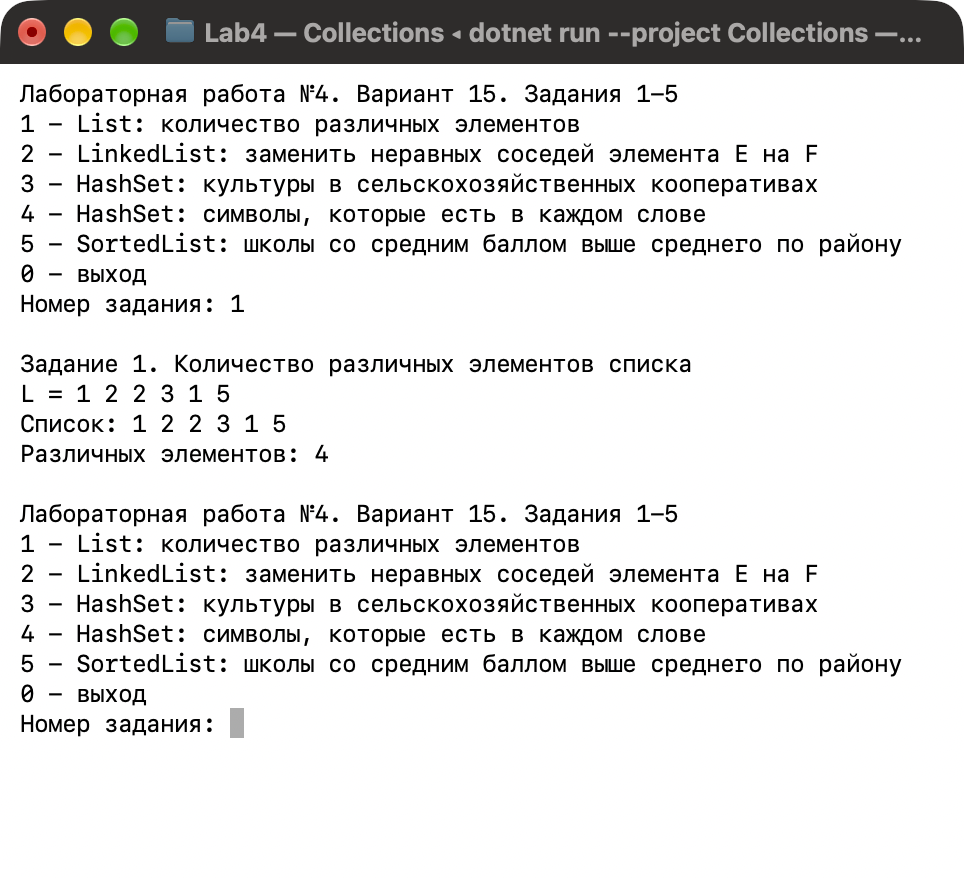

Задание 2: у первого E соседи 1 и 2 различны и заменены на 0, у второго E соседи 2 и 2 равны, последний E соседей с двух сторон не имеет.

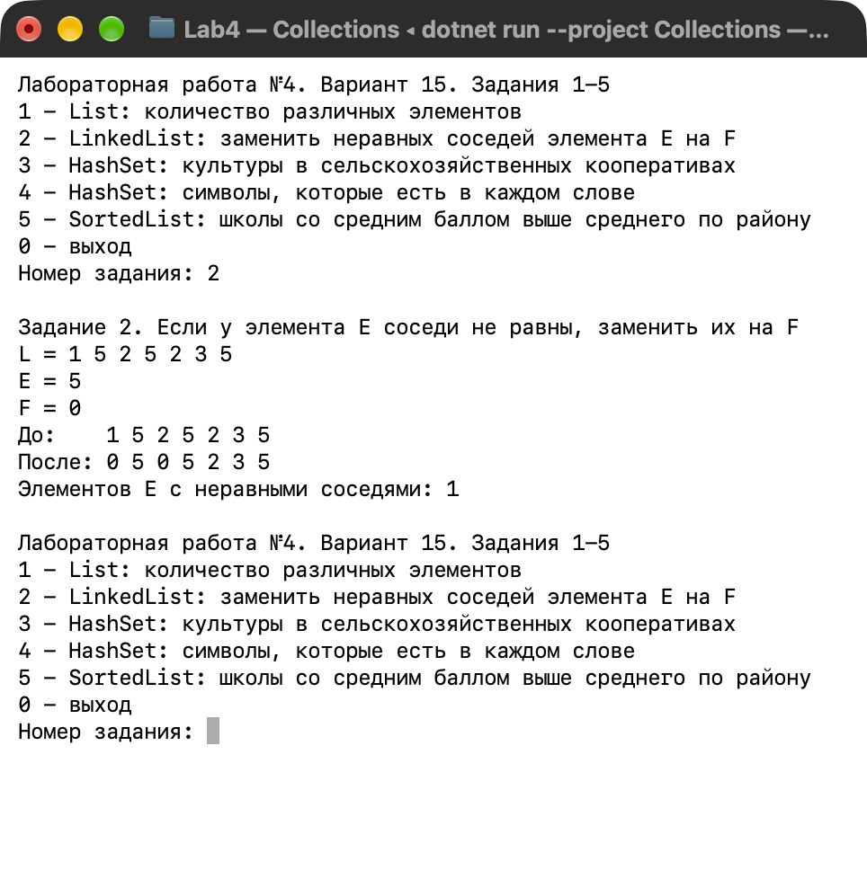

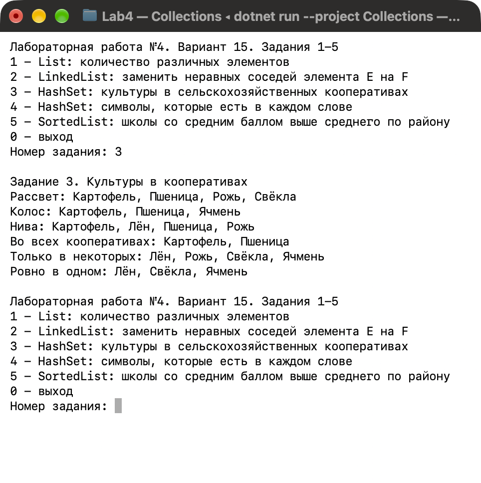

Задание 4: общие для всех слов символы — «а» и «р».

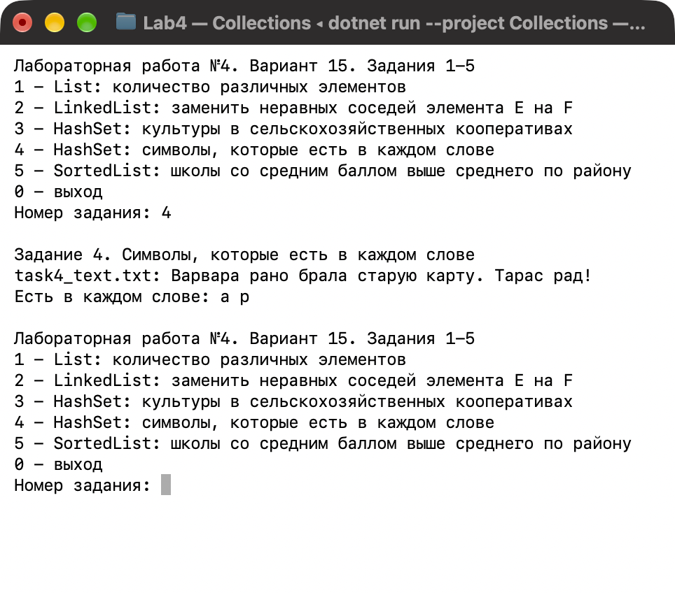

Задание 5: количество 3 отклонено, файл заполнен 8 случайными учениками. Средний по району 438 / 8 = 54.75; школа 18 — (86 + 47) / 2 = 66.5, школа 23 — 55, школа 87 — 91, школа 50 — 159 / 4 = 39.75. Ответ «18 23 87» совпадает с ручным расчётом по файлу.

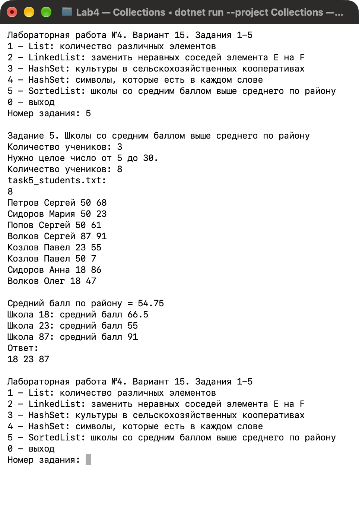

## Задания 6–7 (проект `MoneyOperators`)

Класс `Money`: поля `uint _rubles` и `byte _kopeks`, свойства `Rubles`, `Kopeks`, `TotalKopeks`, конструкторы `Money()`, `Money(uint rubles, byte kopeks)` (копейки только 0–99) и копирующий `Money(Money other)`, `ToString()` в виде «12 руб. 50 коп.».

Задание 6 — сравнение двух сумм: `IsEqualTo(Money other)` и `IsGreaterThan(Money other)` возвращают `bool`.

Задание 7 — перегруженные операции:

| Операция | Действие |
| --- | --- |
| `++` | добавить копейку |
| `--` | вычесть копейку (сумма не может стать меньше 0) |
| `implicit operator uint` | количество рублей, копейки отбрасываются |
| `explicit operator double` | копейки в рублях, результат меньше 1 |
| `Money - int`, `int - Money` | вычесть из суммы указанное число копеек |

Операции не меняют исходный объект, а возвращают новый. Если результат меньше нуля, выбрасывается `InvalidOperationException`, программа выводит сообщение.

### Результаты

Конструкторы и свойства; ввод 105 копеек отклонён:

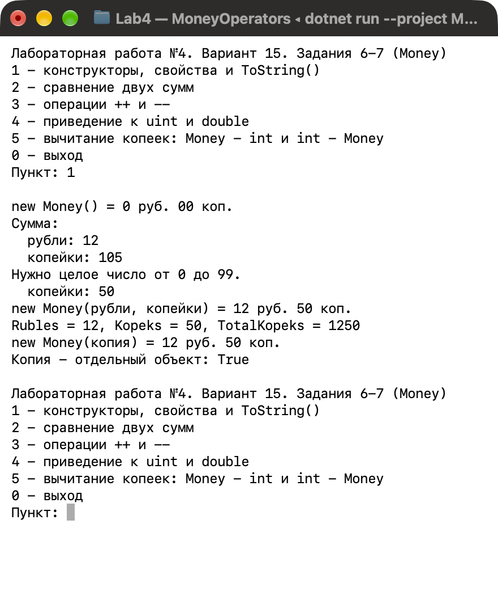

Сравнение двух равных сумм:

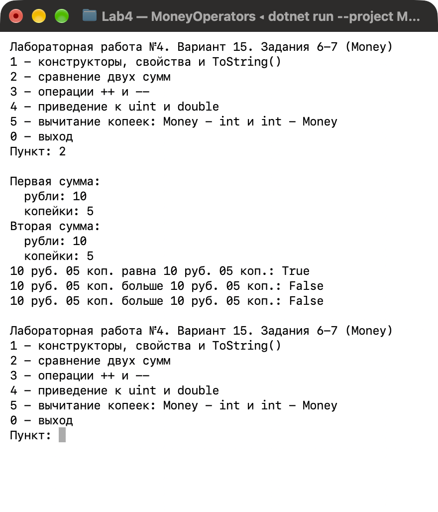

`++` и `--` с переходом через рубль:

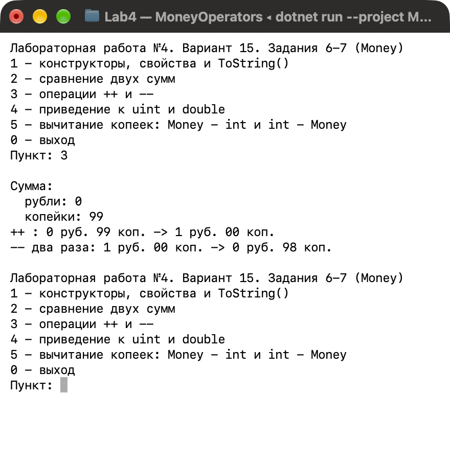

Приведение к `uint` и `double`:

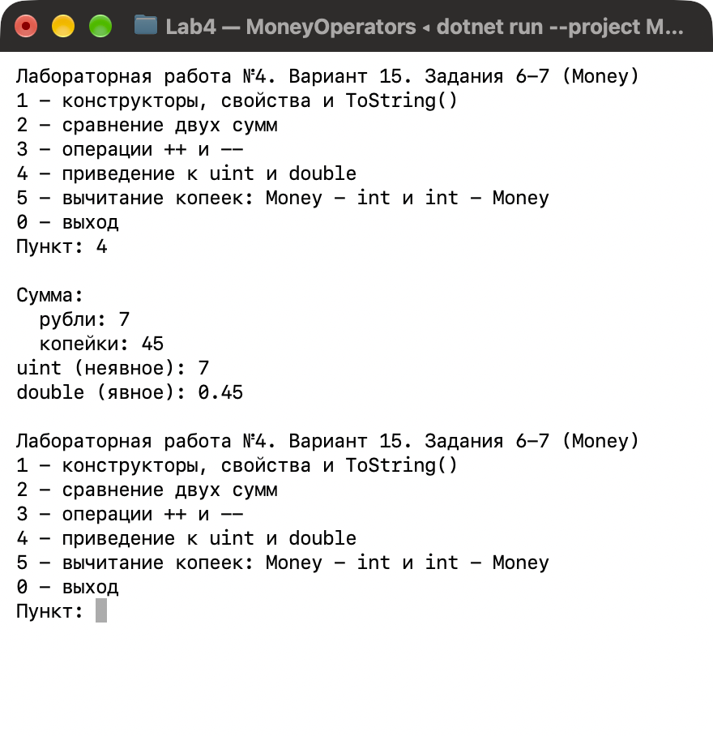

Вычитание копеек с обеих сторон и попытка получить отрицательную сумму:

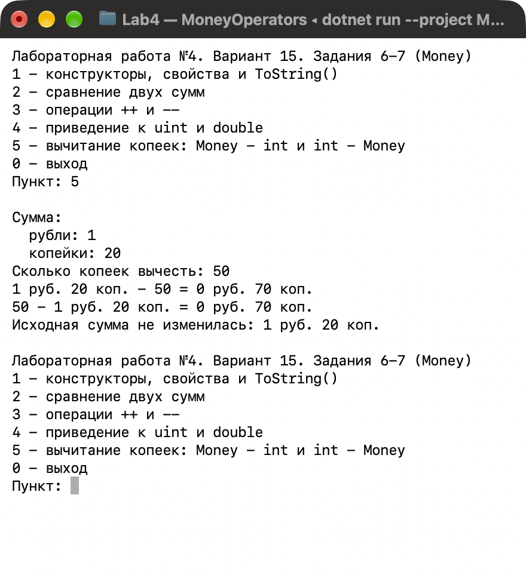

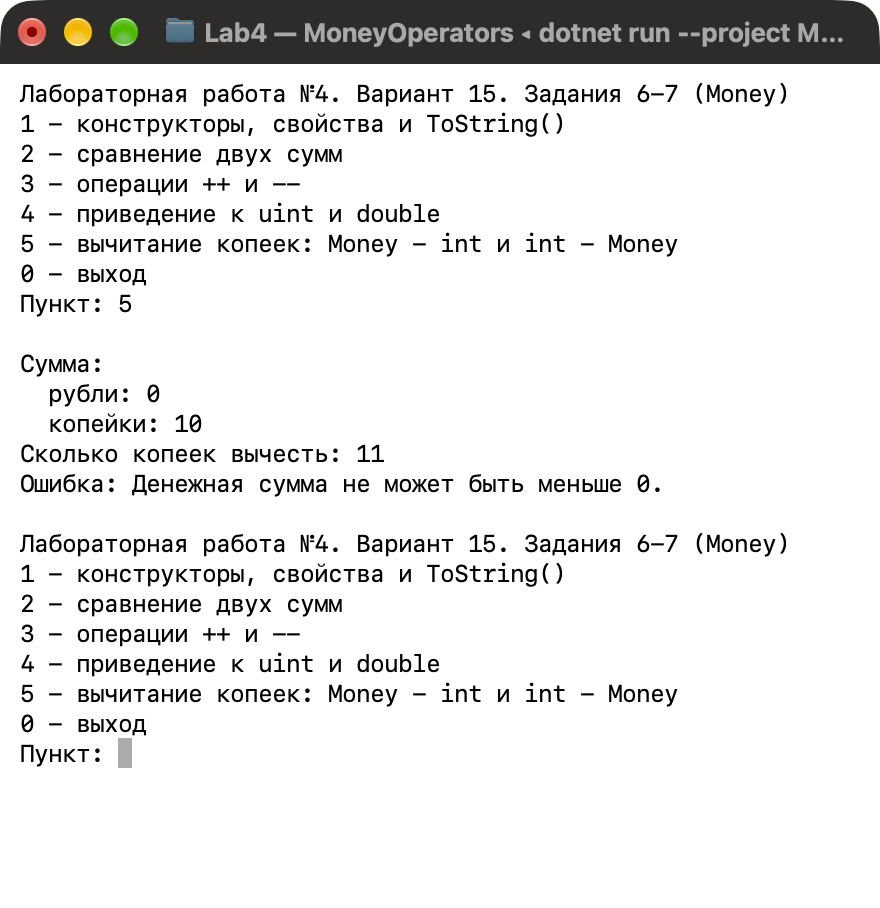
